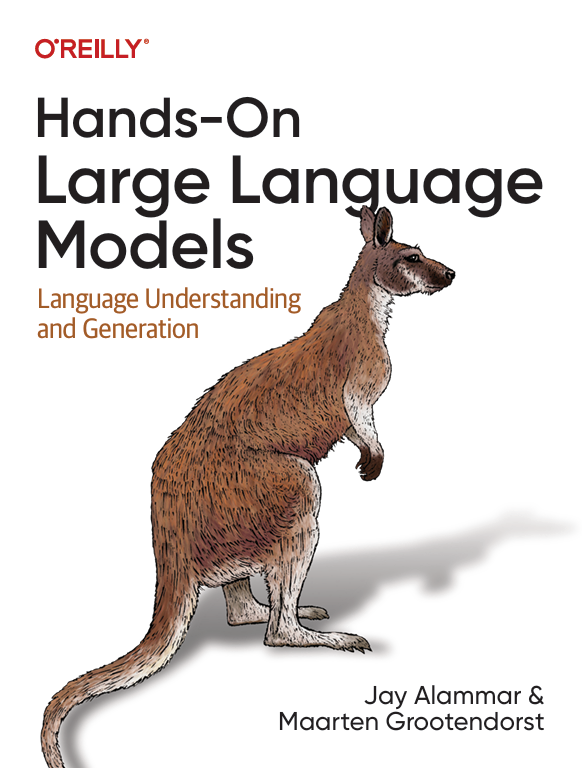
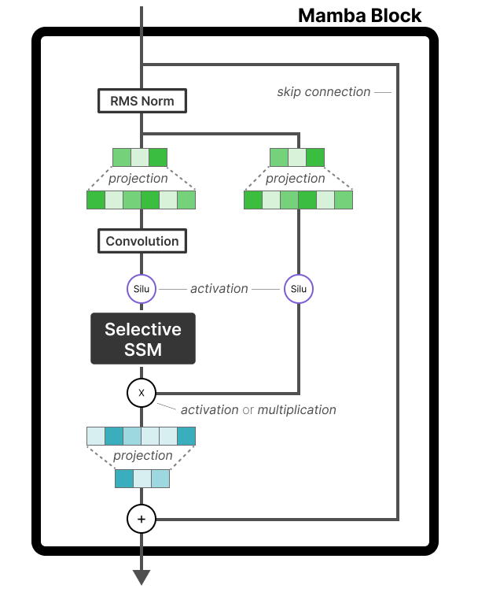
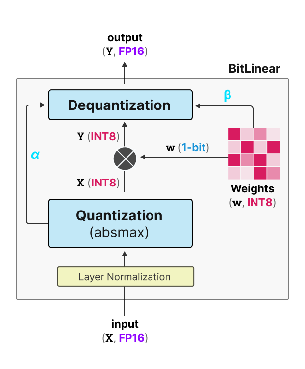
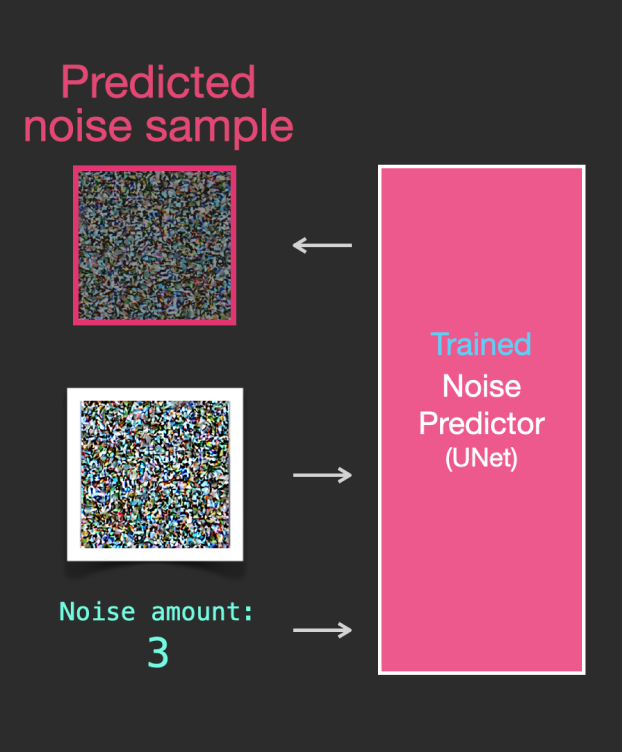
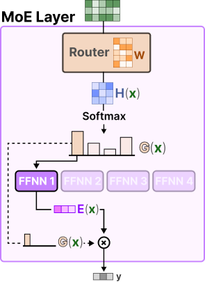
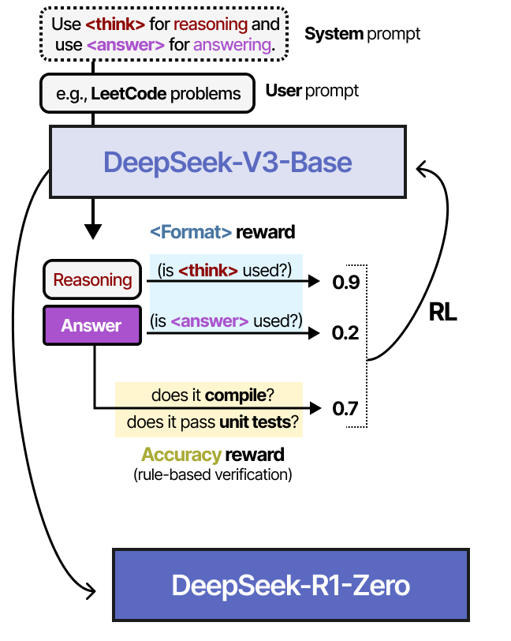
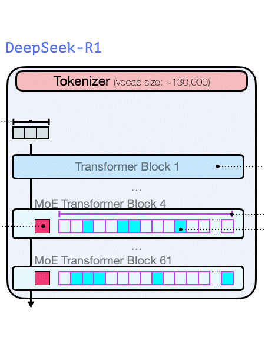

# 핸즈온 LLM (Hands-On Large Language Models) - 한국어판

<a href="https://www.linkedin.com/in/jalammar/"></a>
<a href="https://www.linkedin.com/in/mgrootendorst/"></a>
<a href="https://www.deeplearning.ai/short-courses/how-transformer-llms-work/?utm_campaign=handsonllm-launch&utm_medium=partner"></a>

> [!NOTE]
> 🇰🇷 이 저장소는 [HandsOnLLM/Hands-On-Large-Language-Models](https://github.com/HandsOnLLM/Hands-On-Large-Language-Models)를 한국어로 번역한 비공식 번역본입니다.
> 노트북의 **코드와 프롬프트, 실행 결과는 원본 그대로** 두고, 설명(마크다운 셀)과 코드 주석, 문서만 번역했습니다.
> 번역 기준 원본 커밋: [`ea33908`](https://github.com/HandsOnLLM/Hands-On-Large-Language-Models/commit/ea33908) · 원본 라이선스: [Apache License 2.0](LICENSE) · 번역 관련 안내: [NOTICE](NOTICE)

환영합니다! 이 저장소에는 [Jay Alammar](https://www.linkedin.com/in/jalammar/)와 [Maarten Grootendorst](https://www.linkedin.com/in/mgrootendorst/)가 쓴 책 [Hands-On Large Language Models](https://www.amazon.com/Hands-Large-Language-Models-Understanding/dp/1098150961)에 나오는 모든 예제 코드가 담겨 있습니다. 저자들은 이 책을 장난스럽게 이렇게 부릅니다: <br>

<p align="center"><b><i>"그림으로 보는 LLM 책 (The Illustrated LLM Book)"</i></b></p>

시각적으로 풀어낸 설명과 **직접 제작한 300여 개의 그림**을 통해, 오늘날 대규모 언어 모델(LLM)을 활용하는 데 필요한 실용적인 도구와 개념을 배워 보세요!

<a href="https://www.amazon.com/Hands-Large-Language-Models-Understanding/dp/1098150961"></a>

<br>

책은 다음 곳에서 구할 수 있습니다:

* [Amazon](https://www.amazon.com/Hands-Large-Language-Models-Understanding/dp/1098150961)
* [Shroff Publishers (인도)](https://www.shroffpublishers.com/books/computer-science/large-language-models/9789355425522/)
* [O'Reilly](https://www.oreilly.com/library/view/hands-on-large-language/9781098150952/)
* [Kindle](https://www.amazon.com/Hands-Large-Language-Models-Alammar-ebook/dp/B0DGZ46G88/ref=tmm_kin_swatch_0?_encoding=UTF8&qid=&sr=)
* [Barnes and Noble](https://www.barnesandnoble.com/w/hands-on-large-language-models-jay-alammar/1145185960)
* [Goodreads](https://www.goodreads.com/book/show/210408850-hands-on-large-language-models)

## 목차

가장 쉽게 환경을 구성하려면 모든 예제를 Google Colab에서 실행하는 것을 권장합니다. Google Colab에서는 16GB VRAM을 갖춘 T4 GPU를 무료로 사용할 수 있습니다. 모든 예제는 주로 Google Colab에서 만들고 테스트했기 때문에 가장 안정적인 플랫폼입니다. 물론 다른 클라우드 서비스에서도 동작합니다.

| 장  | 노트북  |
|---|---|
| 1장: 언어 모델 소개  | [](https://colab.research.google.com/github/mooooonmin/Hands-On-Large-Language-Models-ko/blob/main/chapter01/Chapter%201%20-%20Introduction%20to%20Language%20Models.ipynb)   |
| 2장: 토큰과 임베딩  | [](https://colab.research.google.com/github/mooooonmin/Hands-On-Large-Language-Models-ko/blob/main/chapter02/Chapter%202%20-%20Tokens%20and%20Token%20Embeddings.ipynb)  |
| 3장: 트랜스포머 LLM 내부 들여다보기  | [](https://colab.research.google.com/github/mooooonmin/Hands-On-Large-Language-Models-ko/blob/main/chapter03/Chapter%203%20-%20Looking%20Inside%20LLMs.ipynb)  |
| 4장: 텍스트 분류  | [](https://colab.research.google.com/github/mooooonmin/Hands-On-Large-Language-Models-ko/blob/main/chapter04/Chapter%204%20-%20Text%20Classification.ipynb)  |
| 5장: 텍스트 클러스터링과 토픽 모델링  | [](https://colab.research.google.com/github/mooooonmin/Hands-On-Large-Language-Models-ko/blob/main/chapter05/Chapter%205%20-%20Text%20Clustering%20and%20Topic%20Modeling.ipynb)  |
| 6장: 프롬프트 엔지니어링  | [](https://colab.research.google.com/github/mooooonmin/Hands-On-Large-Language-Models-ko/blob/main/chapter06/Chapter%206%20-%20Prompt%20Engineering.ipynb)  |
| 7장: 고급 텍스트 생성 기법과 도구  | [](https://colab.research.google.com/github/mooooonmin/Hands-On-Large-Language-Models-ko/blob/main/chapter07/Chapter%207%20-%20Advanced%20Text%20Generation%20Techniques%20and%20Tools.ipynb)  |
| 8장: 시맨틱 검색과 검색 증강 생성(RAG)  | [](https://colab.research.google.com/github/mooooonmin/Hands-On-Large-Language-Models-ko/blob/main/chapter08/Chapter%208%20-%20Semantic%20Search.ipynb)  |
| 9장: 멀티모달 대규모 언어 모델  | [](https://colab.research.google.com/github/mooooonmin/Hands-On-Large-Language-Models-ko/blob/main/chapter09/Chapter%209%20-%20Multimodal%20Large%20Language%20Models.ipynb)  |
| 10장: 텍스트 임베딩 모델 만들기  | [](https://colab.research.google.com/github/mooooonmin/Hands-On-Large-Language-Models-ko/blob/main/chapter10/Chapter%2010%20-%20Creating%20Text%20Embedding%20Models.ipynb)  |
| 11장: 분류를 위한 표현 모델 미세 튜닝  | [](https://colab.research.google.com/github/mooooonmin/Hands-On-Large-Language-Models-ko/blob/main/chapter11/Chapter%2011%20-%20Fine-Tuning%20BERT.ipynb)  |
| 12장: 생성 모델 미세 튜닝  | [](https://colab.research.google.com/github/mooooonmin/Hands-On-Large-Language-Models-ko/blob/main/chapter12/Chapter%2012%20-%20Fine-tuning%20Generation%20Models.ipynb)  |

> [!TIP]
> 로컬에 모든 패키지를 빠르게 설치하는 방법은 [setup](.setup/) 폴더를, conda와 PyTorch 설치를 포함한 전체 환경 구성 가이드는 [conda](.setup/conda/) 폴더를 참고하세요.
> 운영체제, 파이썬 버전, 의존성 패키지에 따라 결과가 조금씩 다를 수 있습니다. 하지만 책에 나온 예제와 비슷한 결과가 나와야 합니다.


## 추천사

> "*Jay와 Maarten은 이번 새 책에서도 복잡한 주제를 아름다운 그림과 통찰력 있는 설명으로 풀어내는 전통을 이어 갑니다. 실제로 동작하는 코드, 타임라인, 핵심 논문에 대한 참고 자료까지 갖춘 이 책은 대규모 언어 모델이 어떻게 만들어지는지, 그 핵심 기법을 이해하고 싶은 모든 사람에게 귀중한 자료입니다.*"
>
> **Andrew Ng** - [DeepLearning.AI](https://www.deeplearning.ai/) 설립자

---

> "*언어 모델의 세계와 산업 현장에서의 실제 활용을 다룬 탁월한 안내서입니다. 언어 모델의 생성, 표현, 검색 활용을 시각적으로 풍부하게 다루고 있어 독자가 LLM을 빠르게 이해하고, 사용하고, 개선할 수 있게 해 줍니다. 강력히 추천합니다!*"
>
> **Nils Reimers** - Cohere 머신러닝 디렉터 | [sentence-transformers](https://github.com/UKPLab/sentence-transformers) 개발자

---

> "*지금 이 책보다 더 중요한 책은 떠오르지 않습니다. 매 페이지마다 언어 모델 시대에 성공하는 데 꼭 필요한 무언가를 배웠습니다.*"
>
> **Josh Starmer** - [StatQuest](https://www.youtube.com/channel/UCtYLUTtgS3k1Fg4y5tAhLbw)

---

> "*LLM에 관한 모든 것을 빠르게 익히고 싶다면 더 찾아볼 필요가 없습니다! 이 멋진 책에서 Jay와 Maarten은 대규모 언어 모델의 역사와 최신 발전에 대해 여러분을 초보자에서 전문가로 이끌어 줍니다. 매우 직관적인 설명, 훌륭한 실생활 예제, 명확한 그림, 그리고 포괄적인 코드 실습으로 트랜스포머 모델, 토크나이저, 시맨틱 검색, RAG를 비롯한 여러 최첨단 기술의 복잡함을 걷어 냅니다. 최신 AI 기술에 관심 있는 사람이라면 꼭 읽어야 할 책입니다!*"
>
> **Luis Serrano, PhD** - [Serrano Academy](https://www.youtube.com/@SerranoAcademy) 설립자 겸 CEO

---

> "*Hands-On Large Language Models는 명확한 설명과 실용적인 예제로 AI를 둘러싼 과장된 기대를 걷어 냅니다. 명료한 설명을 뒷받침하는 훌륭한 다이어그램과 시각 자료가 풍부합니다. 다른 책들이 추상적으로 남겨 두는 내용을 실습 예제와 코드로 구체화합니다. 간단한 입문 내용으로 시작해 점차 범위를 넓혀 가며, 마지막 장에 이르면 자신감 있게 대규모 언어 모델을 미세 튜닝하고 직접 만들 수 있게 됩니다.*"
>
> **Leland McInnes** - Tutte Institute for Mathematics and Computing 연구원 | [UMAP](https://github.com/lmcinnes/umap)과 [HDBSCAN](https://github.com/scikit-learn-contrib/hdbscan) 개발자

---

## [보너스 콘텐츠!](bonus/)

저자들은 독자가 부담스럽지 않은 선에서 최대한 많은 정보를 책에 담으려 했습니다. 하지만 400쪽에 달하는 책으로도 아직 다룰 내용이 많이 남아 있습니다!

책을 보완하면서 새롭고 [흥미로운 주제](bonus/)를 더 깊이 다루는 가이드를 계속 만들고 있습니다:

| [그림으로 보는 Mamba 가이드](https://newsletter.maartengrootendorst.com/p/a-visual-guide-to-mamba-and-state)             |  [그림으로 보는 양자화 가이드](https://newsletter.maartengrootendorst.com/p/a-visual-guide-to-quantization) | [그림으로 보는 Stable Diffusion](https://jalammar.github.io/illustrated-stable-diffusion/) |
:-------------------------:|:-------------------------:|:-------------------------:
  |   |  
**[그림으로 보는 전문가 혼합(MoE) 가이드](https://newsletter.maartengrootendorst.com/p/a-visual-guide-to-mixture-of-experts)**  | **[그림으로 보는 추론 LLM 가이드](https://newsletter.maartengrootendorst.com/p/a-visual-guide-to-reasoning-llms)**  |  **[그림으로 보는 DeepSeek-R1](https://newsletter.languagemodels.co/p/the-illustrated-deepseek-r1)**
  |   |  

> 보너스 가이드 링크는 원문(영어) 글로 연결됩니다.

## 인용

연구에 도움이 되었다면 이 책을 인용해 주세요:

```
@book{hands-on-llms-book,
  author       = {Jay Alammar and Maarten Grootendorst},
  title        = {Hands-On Large Language Models},
  publisher    = {O'Reilly},
  year         = {2024},
  isbn         = {978-1098150969},
  url          = {https://www.oreilly.com/library/view/hands-on-large-language/9781098150952/},
  github       = {https://github.com/HandsOnLLM/Hands-On-Large-Language-Models}
}
```
