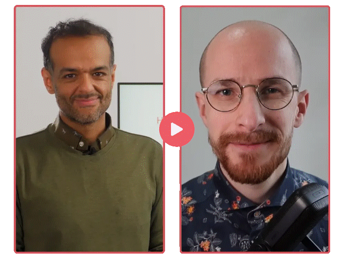

# [트랜스포머 LLM은 어떻게 동작하는가 (How Transformer LLMs Work)](https://www.deeplearning.ai/short-courses/how-transformer-llms-work/?utm_campaign=handsonllm-launch&utm_medium=partner)

이 강좌는 책의 내용을 바탕으로, 트랜스포머 LLM을 이루는 주요 구성 요소를 다루는 짧은 강좌로 확장한 것입니다. **애니메이션이 풍부한** 이 강좌를 통해 책에서 얻은 직관을 한층 더 강화할 수 있습니다.

    

## 배우게 될 내용

* 토큰화, 임베딩, 셀프 어텐션, 트랜스포머 블록 등 트랜스포머의 핵심 구성 요소를 이해해 탄탄한 기술적 기반을 다집니다.
* KV 캐시, 멀티 쿼리 어텐션, 그룹 쿼리 어텐션, 희소 어텐션 등 어텐션 메커니즘에 대한 최근의 트랜스포머 개선 사항을 이해합니다.
* 최신 LLM에서 사용하는 토큰화 전략을 비교하고, Hugging Face Transformers 라이브러리에서 트랜스포머를 살펴봅니다.
