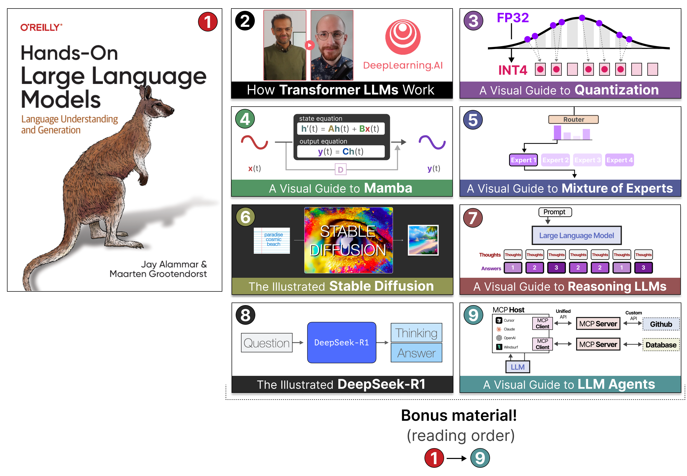
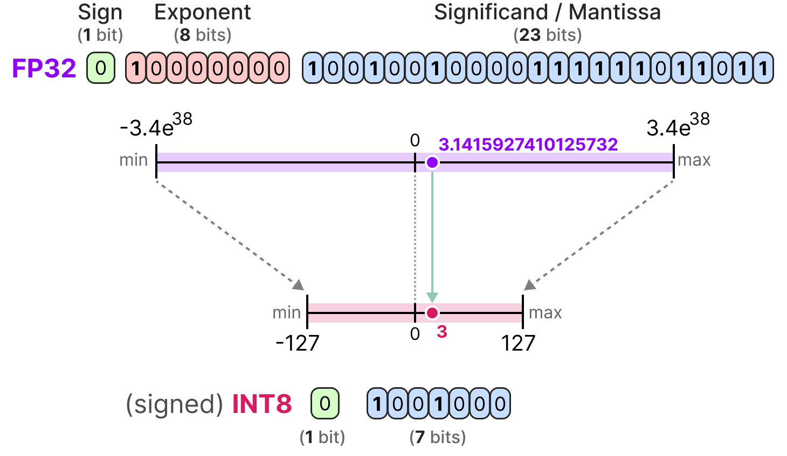
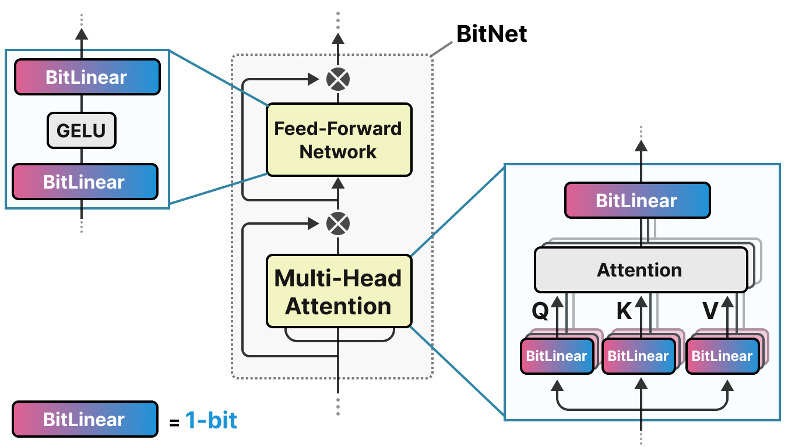

# [그림으로 보는 양자화 가이드 (A Visual Guide to Quantization)](https://newsletter.maartengrootendorst.com/p/a-visual-guide-to-quantization) (7장과 12장 확장)

책에서는 양자화의 개념을 다루고, 양자화를 사용해 훈련과 미세 튜닝에 필요한 계산 자원을 어떻게 줄일 수 있는지 보여 줍니다.

[그림으로 보는 양자화 가이드](https://newsletter.maartengrootendorst.com/p/a-visual-guide-to-quantization)는 책에서 소개한 기본 개념을 바탕으로, 이 기법의 기술적인 세부 사항을 더 깊이 파고듭니다.

이 가이드는 훈련 후 양자화(post-training quantization)와 양자화 인식 훈련(quantization-aware training) 등 다양한 양자화 방법을 살펴봅니다. 파라미터를 세 가지 값으로 표현하는(3진 파라미터!) 방법인 BitNet도 소개합니다.

책의 내용을 확장한 이 가이드를 통해 독자는 고급 주제를 빠르게 따라잡을 수 있습니다. 책 다음에 읽기 좋은 훌륭한 다음 단계입니다.
