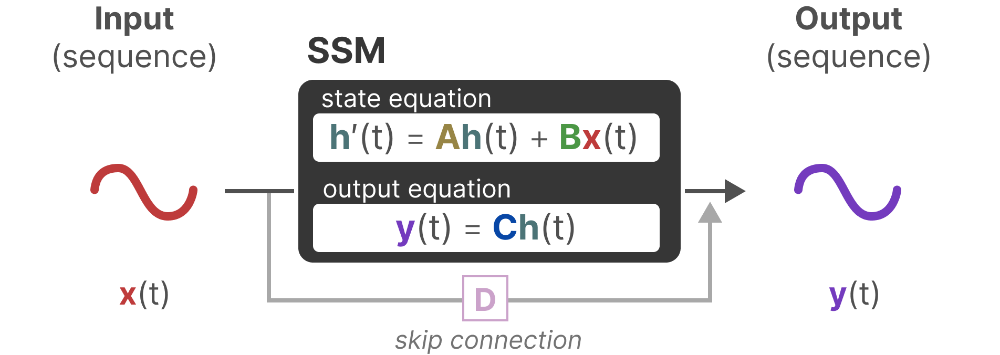
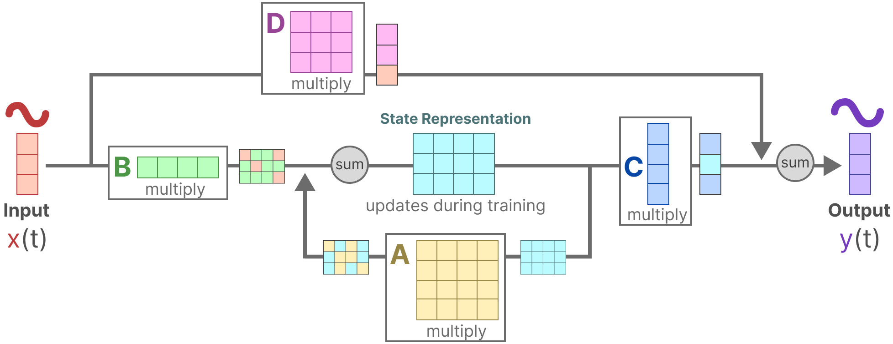

# [그림으로 보는 Mamba 가이드 (A Visual Guide to Mamba)](https://newsletter.maartengrootendorst.com/p/a-visual-guide-to-mamba-and-state) ("대안"이 되는 3장)

3장을 확장하는 대신, 아예 "대체"해 봅시다! 좀 더 정확히 말하면, 대안을 제시해 봅시다.

[그림으로 보는 Mamba와 상태 공간 모델 가이드](https://newsletter.maartengrootendorst.com/p/a-visual-guide-to-mamba-and-state)는 3장에서 다룬 트랜스포머 아키텍처에 대한 흥미로운 대안을 제시합니다. 3장이 디코더 기반 트랜스포머 모델에 초점을 맞춘다면, 이 블로그 글은 시퀀스 모델링에 대한 근본적으로 다른 접근 방식을 소개합니다.

이 대안 아키텍처를 살펴보면서, 이 글은 이 분야에 트랜스포머만 있는 것이 아니라는 점을 보여 주며 3장을 보완합니다. 흥미롭게도 [트랜스포머 블록과 Mamba 블록을 결합한](https://www.ai21.com/blog/announcing-jamba) 하이브리드 아키텍처도 등장하기 시작했습니다.

