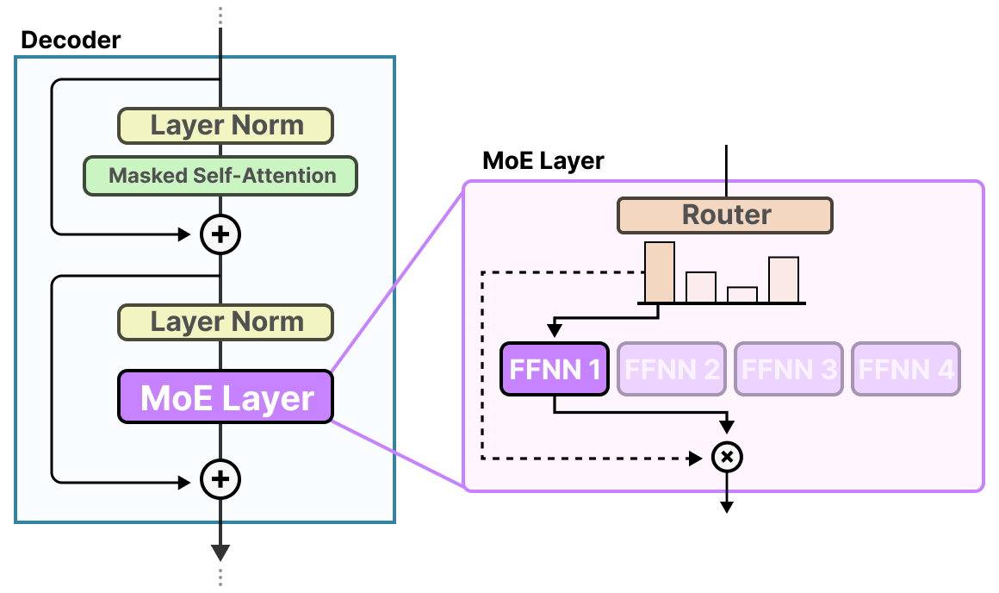
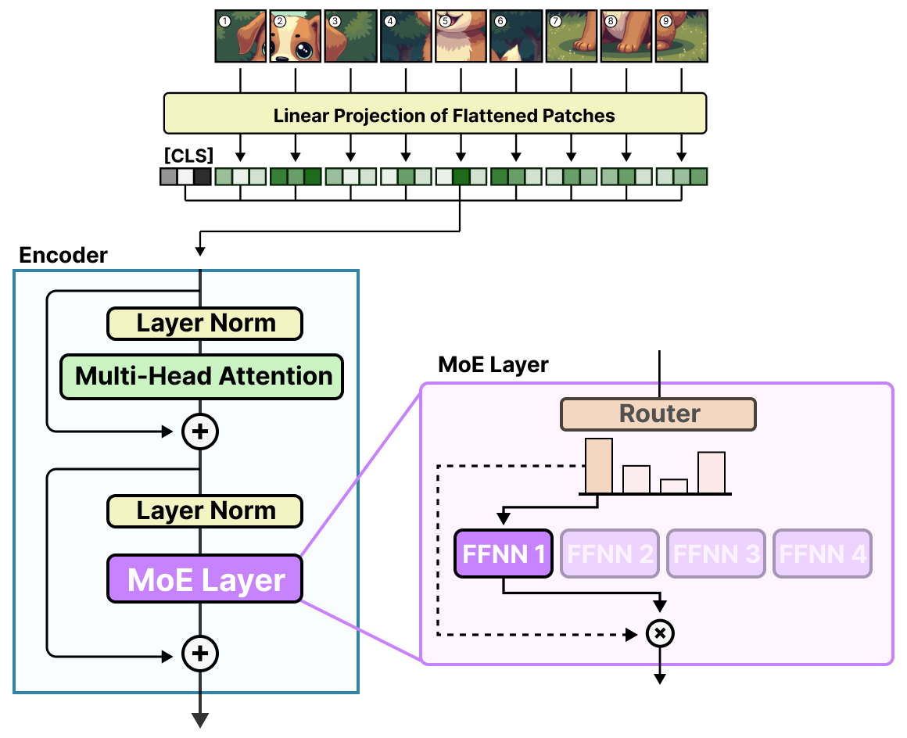

# [그림으로 보는 전문가 혼합 가이드 (A Visual Guide to Mixture of Experts)](https://newsletter.maartengrootendorst.com/p/a-visual-guide-to-mixture-of-experts) (3장 확장)

3장에서는 전통적인 트랜스포머 디코더와 그 동작 방식에 대한 탄탄한 기초를 다룹니다. 효율적인 어텐션, 위치 임베딩의 발전 같은 고급 주제도 다룹니다.

책에서 자세히 다루지는 않았지만 점점 주목받고 있는 주제가 바로 전문가 혼합(Mixture of Experts)입니다. 여러 개의 전문화된 하위 네트워크, 즉 "전문가(expert)"를 도입해 트랜스포머 디코더를 강화하는 기법입니다.

[그림으로 보는 전문가 혼합(MoE) 가이드](https://newsletter.maartengrootendorst.com/p/a-visual-guide-to-mixture-of-experts)는 MoE 모델이 서로 다른 입력을 가장 적합한 전문가에게 동적으로 라우팅해 다양한 언어 작업을 더 효율적으로 처리하는 과정을 그림으로 설명합니다.

또 하나의 보너스로, 이 글은 비전 언어 모델 분야까지 다룹니다:

이 고급 개념을 3장에서 다룬 디코더 기초와 연결하면, 복잡해 보이지만 실제로는 간단한 전문가 혼합 기법을 빠르게 익힐 수 있습니다.
