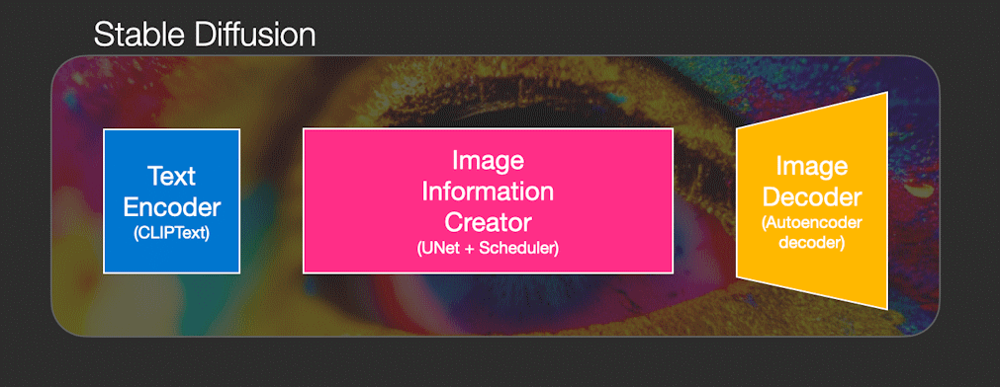
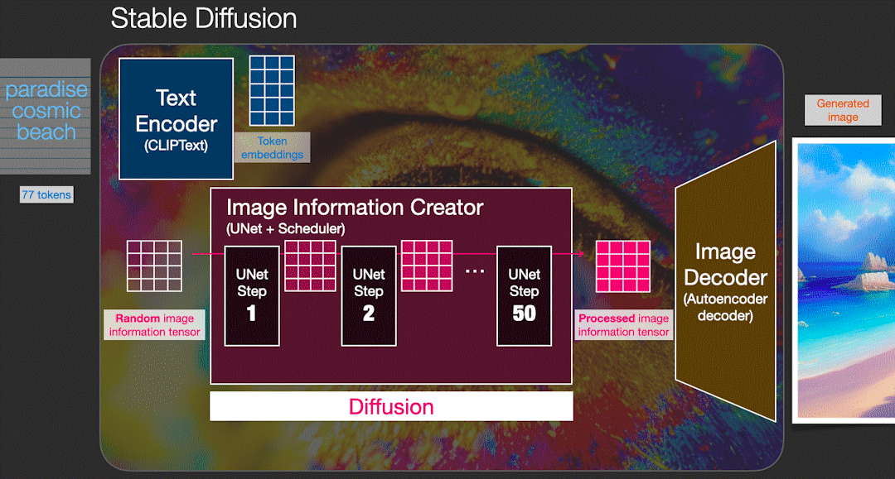

# [그림으로 보는 Stable Diffusion (The Illustrated Stable Diffusion)](https://jalammar.github.io/illustrated-stable-diffusion/) (9장 확장)

9장에서는 비전 트랜스포머(ViT)를 다루고, CLIP을 통해 텍스트와 이미지를 함께 모델링하는 방법을 살펴봅니다. CLIP으로 텍스트 모델에 이미지를 연결해, 모델이 텍스트뿐 아니라 이미지에 대해서도 "추론"할 수 있게 하는 방법을 보여 줍니다.

하지만 CLIP은 그 반대 방향, 즉 비전 모델에 텍스트를 연결하는 데도 쓸 수 있습니다. 입력 텍스트를 모델이 만드는 이미지의 가이드로 사용하는 것이죠.

[그림으로 보는 Stable Diffusion](https://jalammar.github.io/illustrated-stable-diffusion/)은 Stable Diffusion에서 CLIP이 하는 역할을, 책을 읽은 독자라면 기대할 법한 시각적인 방식으로 살펴봅니다.

또한 Stable Diffusion의 내부 동작을 그림으로 설명하며, CLIP의 능력과 고급 확산 모델을 결합해 텍스트 프롬프트로 고품질 이미지를 만드는 과정을 보여 줍니다.

책은 주로 텍스트 생성에 초점을 맞추지만, 이미지 생성 과정도 상당 부분 겹칩니다. 더 많은 아키텍처, 기술, 방법이 다양한 도메인과 모달리티로 확장되고 있는 만큼, 이 그림 가이드는 9장을 잘 보완해 줍니다.
