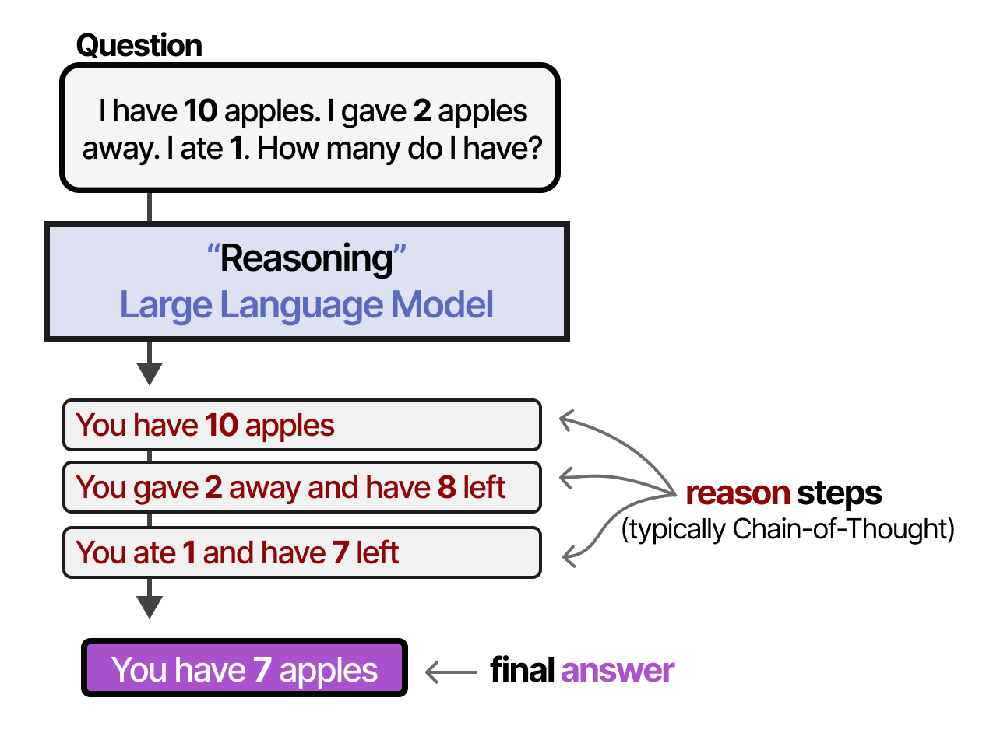
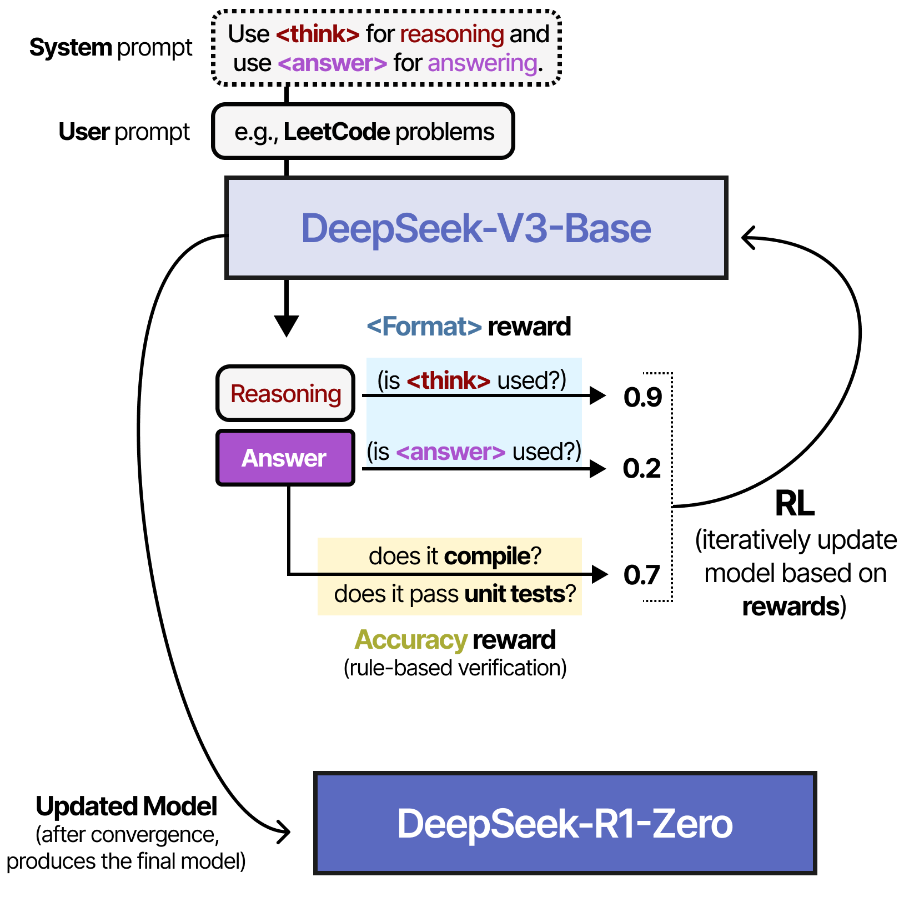

# [그림으로 보는 추론 LLM 가이드 (A Visual Guide to Reasoning LLMs)](https://newsletter.maartengrootendorst.com/p/a-visual-guide-to-reasoning-llms) (6장과 12장 확장)

책에서는 확장된 추론으로 출력 품질을 높이는 생각의 사슬(chain-of-thought) 개념을 다룹니다.

[그림으로 보는 추론 LLM 가이드](https://newsletter.maartengrootendorst.com/p/a-visual-guide-to-reasoning-llms)는 LLM이 폭넓은 추론 과정을 보여 주도록 만드는 방법을 더 깊이 다룹니다. 이 책의 초점인 **훈련 시점 계산(train-time compute)**(더 많은 데이터, 더 긴 훈련, 더 큰 모델)에서 **테스트 시점 계산(test-time compute)**("추론"으로 추론 단계를 늘리는 것)으로의 패러다임 전환을 설명합니다.

이 가이드는 훈련과 추론 단계 모두에서 LLM에 추론 능력을 증류하는 다양한 기법을 살펴봅니다. 2024년에 큰 영향을 미친 모델인 DeepSeek-R1을 다루는 섹션도 있습니다.

