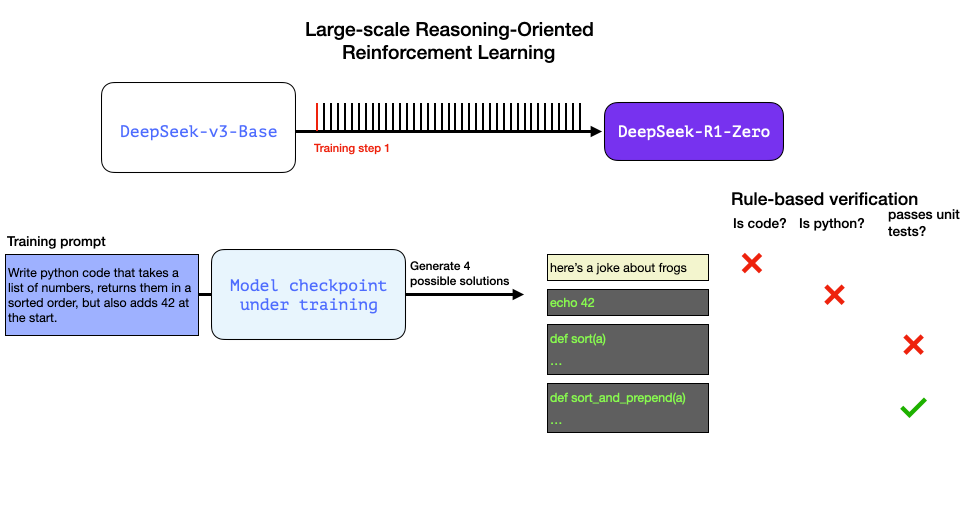
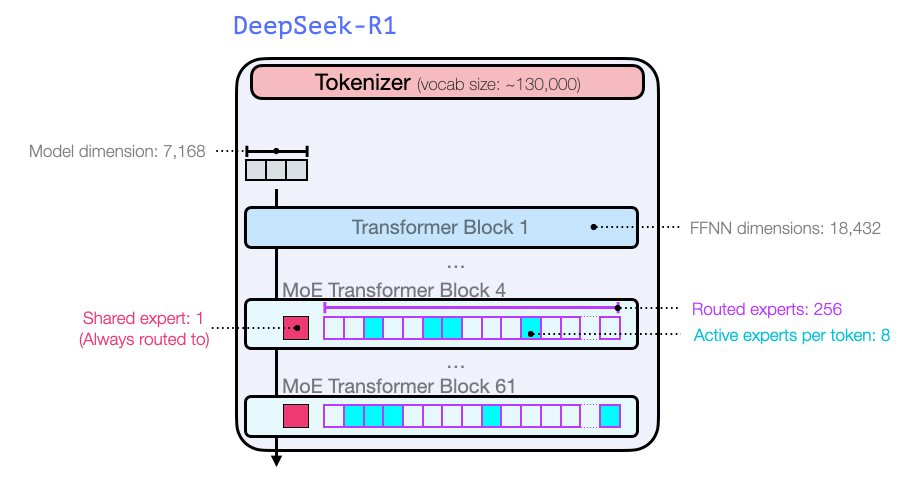

# [그림으로 보는 DeepSeek-R1 (The Illustrated DeepSeek-R1)](https://newsletter.languagemodels.co/p/the-illustrated-deepseek-r1/) (12장 확장)

12장에서는 모델을 만들고 미세 튜닝하는 일반적인 기법인 언어 모델링, 지도 미세 튜닝, 선호도 튜닝을 살펴봅니다. 이 장은 추론 모델이 아닌 모델에 초점을 맞추고, 직접 모델을 미세 튜닝하는 방법을 보여 줍니다.

DeepSeek-R1은 OpenAI의 o1 모델에 필적하는 오픈 웨이트 LLM으로 엄청난 파장을 일으켰습니다. DeepSeek-R1은 예상치 못하게 공개된 추론 LLM입니다.

[그림으로 보는 DeepSeek-R1](https://newsletter.languagemodels.co/p/the-illustrated-deepseek-r1/)은 이 모델과 훈련 과정을 살펴봅니다. 이렇게 뛰어난 능력을 갖춘 모델을 만들기 위해 거친 여러 단계를 하나씩 짚어 봅니다.

흥미롭게도 이 모델은 규칙 기반 검증기를 사용해 추론 과정이 일정한 기준을 따르도록 합니다. 예를 들어 코드가 실제로 컴파일되는지 확인하는 식입니다:

아키텍처는 [전문가 혼합(Mixture-of-Experts)](https://newsletter.maartengrootendorst.com/p/a-visual-guide-to-mixture-of-experts) 구조이며, 전문가가 256개(한 번에 8개 활성화)나 되는 꽤 큰 모델입니다:

