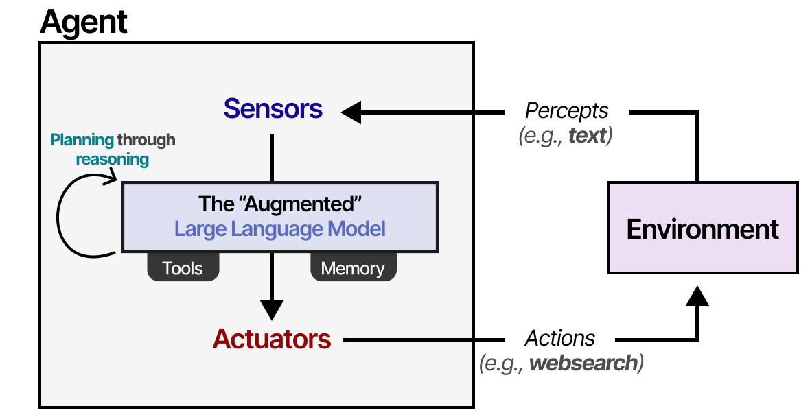
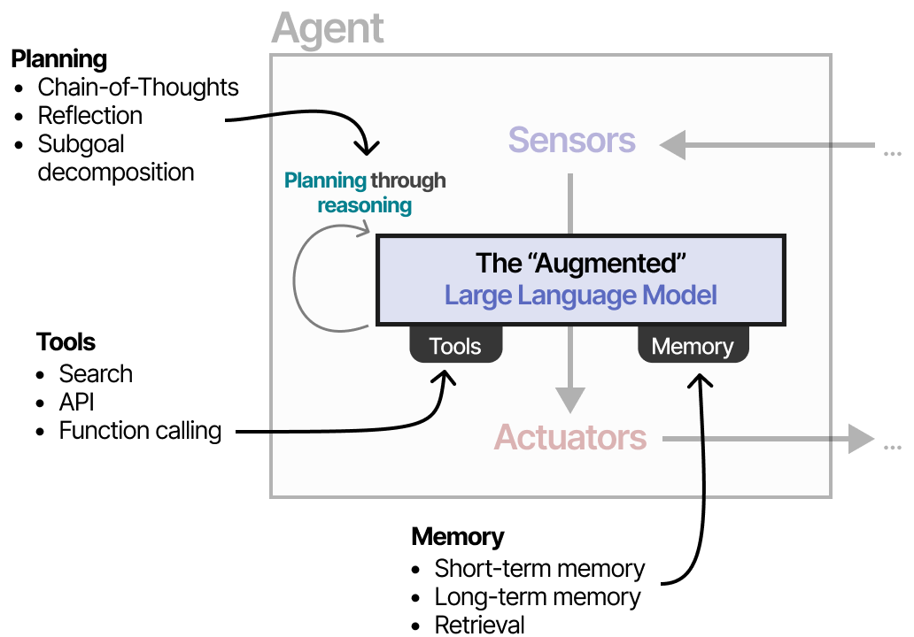
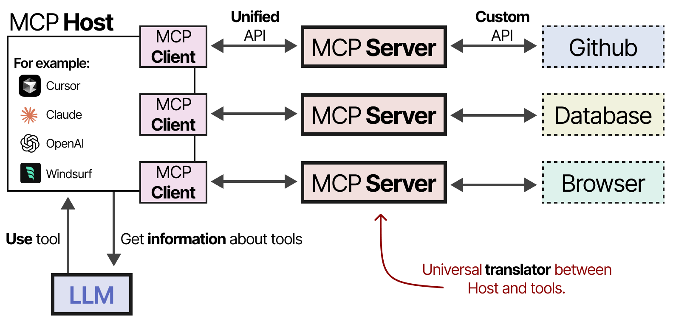
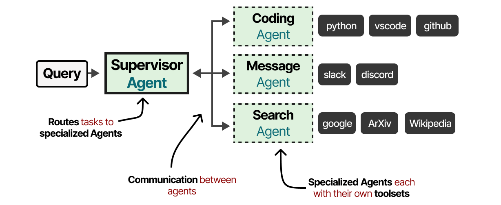

# [그림으로 보는 LLM 에이전트 가이드 (A Visual Guide to LLM Agents)](https://newsletter.maartengrootendorst.com/p/a-visual-guide-to-llm-agents) (7장과 8장 확장)

7장과 8장에서는 LLM에 도구, 메모리 등을 제공해 능력을 확장하는 방법을 보여 줍니다. 추론과 행동(Reason and Act, ReAct)처럼 자율적인 행동을 가능하게 하는 방법론도 간단히 다뤘습니다.

[그림으로 보는 LLM 에이전트 가이드](https://newsletter.maartengrootendorst.com/p/a-visual-guide-to-llm-agents)는 다양한 방법으로 LLM을 자율적으로 만드는 것(이를 에이전트라고 부릅니다)을 더 깊이 다룹니다.

먼저 에이전트의 주요 구성 요소를 간단히 살펴본 다음...

... 각 구성 요소(**도구**, **메모리**, **계획**)를 더 자세히 설명합니다.

도구와 관련해서는, 에이전트의 도구 사용을 가능하게 하는 방법으로 점점 인기를 얻고 있는 **모델 컨텍스트 프로토콜(Model Context Protocol, MCP)**을 깊이 있게 살펴봅니다.

**계획**은 LLM 에이전트의 자율적인 행동을 가능하게 하는 핵심 구성 요소이므로 이 가이드의 중심 내용입니다.

자율적인 행동은 첫걸음일 뿐이며, 이 가이드는 여러 에이전트가 함께 일하며 미리 정한 목표를 달성하는 멀티 에이전트 협업을 설명하며 마무리합니다.

