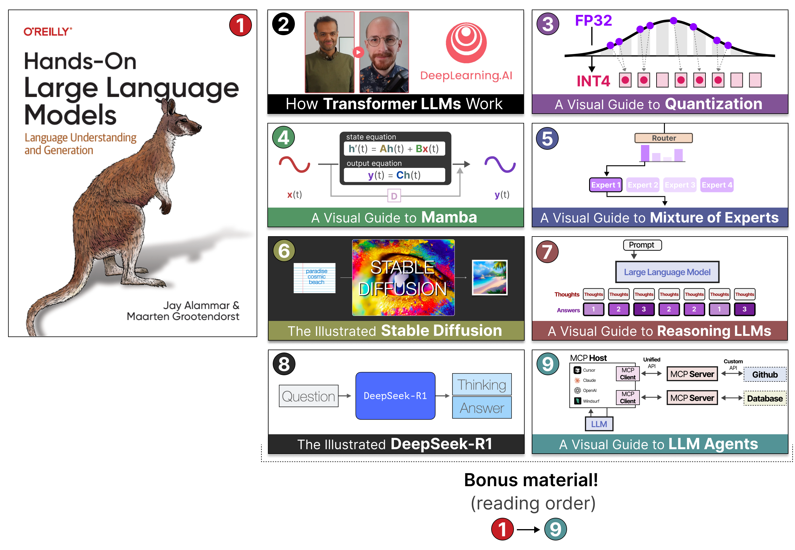

# 보너스 자료

최근 몇 년간 언어 AI가 엄청나게 성장하면서, 모든 내용을 책 한 권에 담는 것은 (400쪽이나 되는데도!) 거의 불가능해졌습니다.
그렇다고 이 규모와 성장의 문제에 대한 창의적인 해결책을 찾으려는 시도조차 하지 말아야 한다는 뜻은 아닙니다.

저자들은 책에서 LLM의 기본기를 다루기로 했고, 덕분에 흥미로운 기회가 생겼습니다.
책을 출발점으로 삼아, 책에서는 그런 방식으로 다룰 수 없었던 특정 주제를 깊이 있게 탐구하는
시각적인 그림 중심 콘텐츠를 계속 만들어 갈 수 있게 된 것입니다.

<i>모든 보너스 자료는 책과 같은 <b>시각적</b>이고 <b>그림 중심</b>의 스타일로 책의 내용을 보완합니다</i>

책을 읽고 나면, 시각 자료가 풍부하고 자세하며 깊이 있는 가이드로 더 복잡한 주제를 공부할 준비가 된 것입니다. 이미 저자들의 그림 스타일에 익숙하기 때문에 이런 고급 개념도 술술 읽힐 거예요!

각 추가 콘텐츠가 어떤 내용인지 알고 싶다면 이 폴더의 마크다운 파일을 클릭해 간단한 소개를 읽어 보세요. 아니면 아래의 시각 교육 자료로 바로 이동할 수도 있습니다(링크는 원문 영어 자료로 연결됩니다):

1. [**Hands-On Large Language Models**](https://www.amazon.com/Hands-Large-Language-Models-Understanding/dp/1098150961)
2. [**트랜스포머 LLM**은 어떻게 동작하는가 (How Transformer LLMs Work)](https://www.deeplearning.ai/short-courses/how-transformer-llms-work/?utm_campaign=handsonllm-launch&utm_medium=partner)
3. [그림으로 보는 **양자화** 가이드 (A Visual Guide to Quantization)](https://newsletter.maartengrootendorst.com/p/a-visual-guide-to-quantization)
4. [그림으로 보는 **Mamba와 상태 공간 모델** 가이드 (A Visual Guide to Mamba and State Space Models)](https://newsletter.maartengrootendorst.com/p/a-visual-guide-to-mamba-and-state)
5. [그림으로 보는 **전문가 혼합(MoE)** 가이드 (A Visual Guide to Mixture of Experts)](https://newsletter.maartengrootendorst.com/p/a-visual-guide-to-mixture-of-experts)
6. [그림으로 보는 **Stable Diffusion** (The Illustrated Stable Diffusion)](https://jalammar.github.io/illustrated-stable-diffusion/)
7. [그림으로 보는 **추론 LLM** 가이드 (A Visual Guide to Reasoning LLMs)](https://newsletter.maartengrootendorst.com/p/a-visual-guide-to-reasoning-llms)
8. [그림으로 보는 **DeepSeek-R1** (The Illustrated DeepSeek-R1)](https://newsletter.languagemodels.co/p/the-illustrated-deepseek-r1)
9. [그림으로 보는 **LLM 에이전트** 가이드 (A Visual Guide to LLM Agents)](https://newsletter.maartengrootendorst.com/p/a-visual-guide-to-llm-agents)
